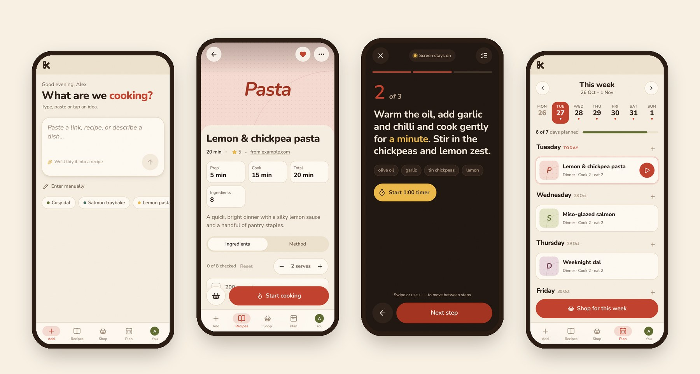
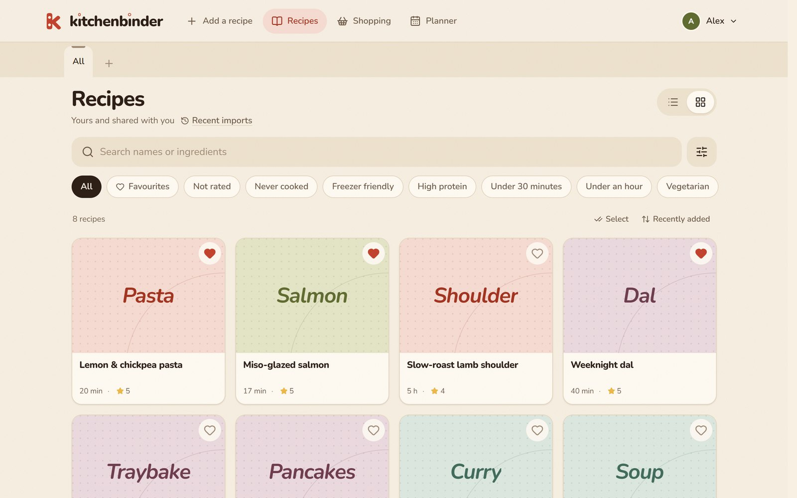
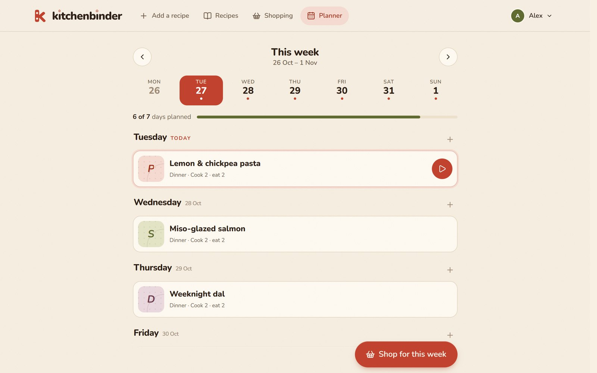
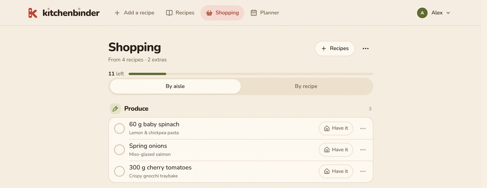

<p align="center">
  
</p>

<p align="center">
  <strong>Good recipes, all together.</strong><br>
  Save recipes from anywhere, plan the week, shop once and cook without the clutter.
</p>

<p align="center">
  <a href="https://kitchenbinder.app"><strong>Open Kitchenbinder →</strong></a>
  &nbsp;·&nbsp;
  <a href="https://github.com/DanielSayer/kitchenbinder/issues">Report an issue</a>
</p>

<p align="center">
  
</p>

## What it does

**🔗 Save any recipe in seconds.** Paste a link, paste the text or just describe a dish. Kitchenbinder tidies it into a clean recipe: no life story, no pop-ups. Share a link from your phone straight into the app on Android.

**📖 One binder for everything.** Search by name or ingredient, filter by tags like *Under 30 minutes* or *Vegetarian*, favourite the keepers and rate what you've cooked. Recipes without a photo get a cover anyway.

**🗓️ Plan the week.** Drop recipes onto days, note the takeaway nights, and see at a glance how much of the week is sorted.

**🛒 Shop once.** Turn the week's plan into one shopping list grouped by aisle. Tick things off in the shop, or mark what you already have at home.

**👩‍🍳 Cook mode.** Big, readable steps in a dark kitchen-friendly theme. Timers are pulled straight from the method, the screen stays on, and you swipe between steps.

**🏠 Share with your household.** Make a household for family or flatmates. Share the recipes you choose and plan and shop together. Your personal recipes stay yours.

**🖨️ Print a proper recipe sheet.** Any recipe becomes a tidy, mostly-white A4 page with tick boxes for ingredients and space for kitchen notes.

**📱 Works like an app.** Install it on your home screen. It's built mobile-first, with a bottom tab bar and sheets that slide up instead of new pages.

## A closer look

<table>
  <tr>
    <td width="50%"></td>
    <td width="50%"></td>
  </tr>
  <tr>
    <td align="center"><sub><b>Your library</b>: search, filter, favourite, rate</sub></td>
    <td align="center"><sub><b>The planner</b>: a week of dinners at a glance</sub></td>
  </tr>
  <tr>
    <td colspan="2"></td>
  </tr>
  <tr>
    <td colspan="2" align="center"><sub><b>The shopping list</b>: grouped by aisle, linked back to each recipe</sub></td>
  </tr>
</table>

## Built with

[TanStack Start](https://tanstack.com/start) · React · tRPC · PostgreSQL · [Better Auth](https://better-auth.com) · Vercel AI SDK · React PDF

The design system ("Pantry") is documented in [DESIGN.md](DESIGN.md).

## Run it locally

You'll need Node, pnpm and Docker.

```sh
pnpm install
pnpm db:start
cp apps/web/.env.example apps/web/.env   # then fill in auth credentials
node --env-file=apps/web/.env packages/db/scripts/migrate.mjs
pnpm dev
```

Open http://localhost:3001.

Environment variables, sign-in providers, testing, deployment and the import worker are covered in [docs/development.md](docs/development.md).
